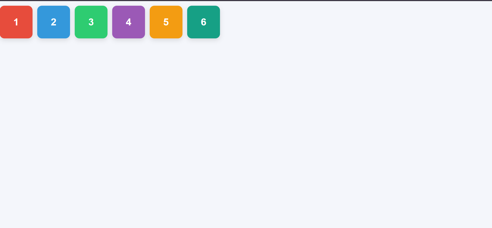
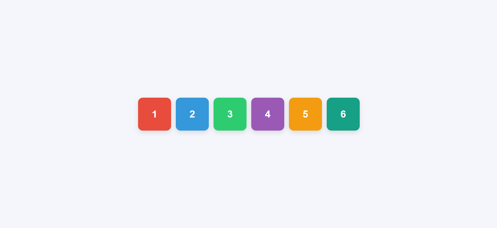
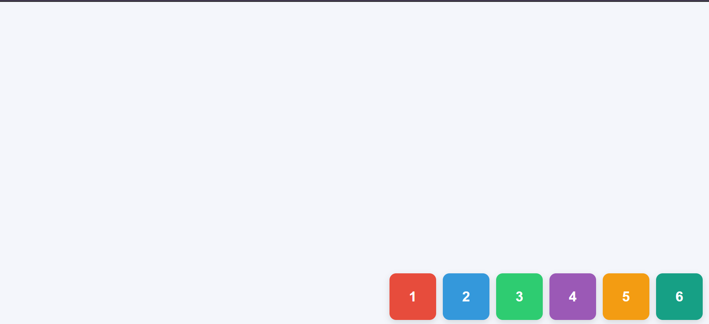

# CSS Flexbox Position Practice

## Project Overview

This project demonstrates how CSS Flexbox positions six colored, numbered boxes inside a full-screen container. The boxes move repeatedly through nine positions using CSS animations without JavaScript.

## Technologies Used

- **HTML5:** Creates the page structure and six numbered boxes.
- **CSS3:** Styles the boxes, controls the Flexbox layout, and animates their positions.
- **Git and GitHub:** Track changes and share the project.

## How the Code Works

### 1. HTML Structure

The HTML contains a main Flexbox container with six boxes numbered 1 through 6. Each box has a CSS class that controls its appearance.

### 2. Flexbox Container

The `.flex-container` uses `display: flex` to arrange the boxes along the main axis.

- `width: 100%` makes the container fill the available width.
- `height: 100vh` makes it as tall as the browser viewport.
- `justify-content` controls horizontal distribution.
- `align-items` controls vertical alignment.
- `gap` creates space between boxes.
- `padding` adds space between the container's edges and the boxes.

### 3. Other Flexbox Properties

- `flex-direction` controls the direction in which flex items are arranged.
- `flex-wrap` controls whether items can wrap onto another line.
- `align-content` controls the spacing of multiple flex lines when wrapping occurs.
- `flex-shrink: 0` prevents boxes from shrinking below their specified size.

These properties have different effects. The animation primarily uses `justify-content` and `align-items` to move the boxes through the nine positions.

### 4. CSS Animation

The `@keyframes moveBoxes` rule defines how the layout changes over time.

- `animation-name` selects the keyframes to run.
- `animation-duration: 27s` sets the animation cycle to 27 seconds.
- `animation-timing-function: steps(1, end)` switches between defined layouts in distinct steps.
- `animation-iteration-count: infinite` repeats the animation continuously.

The animation changes `justify-content` and `align-items` without using JavaScript.

### 5. The Nine Positions

The animation combines three horizontal alignments with three vertical alignments to create nine positions.

| Position | `justify-content` | `align-items` |
|---|---|---|
| Top Left | `flex-start` | `flex-start` |
| Top Center | `center` | `flex-start` |
| Top Right | `flex-end` | `flex-start` |
| Middle Left | `flex-start` | `center` |
| Center | `center` | `center` |
| Middle Right | `flex-end` | `center` |
| Bottom Left | `flex-start` | `flex-end` |
| Bottom Center | `center` | `flex-end` |
| Bottom Right | `flex-end` | `flex-end` |

### 6. Screenshots

### Top-left position

### Centre position

### Bottom-right position

### 7. Video Demonstration

Video link: TO BE ADDED

### 8. GitHub Repository

Repository link: https://github.com/roxaneisaro12/week2-flexbox-practice.git

## What I Learned

I learned how Flexbox arranges elements horizontally and vertically, how `justify-content` and `align-items` work together, and how CSS keyframes can animate layouts repeatedly without JavaScript. I also practiced documenting code and tracking project changes with Git.
